# Paróquia Nossa Senhora Aparecida — Jardim Ingá


Portal da Paróquia Nossa Senhora Aparecida, no Jardim Ingá (Diocese de Luziânia, GO). O site público e o painel da equipe paroquial rodam juntos em uma aplicação Next.js com Payload CMS e PostgreSQL. A equipe atualiza horários de missa, agenda, notícias, comunidades e pastorais pelo painel, sem mexer em código.

<p align="center">
  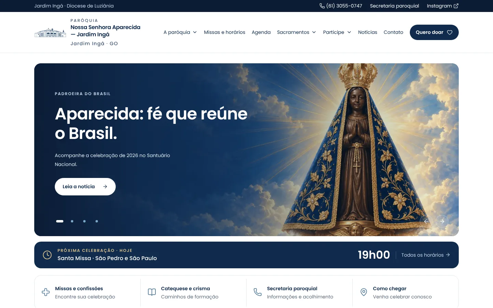
</p>

> [!NOTE]
> O conteúdo de demonstração (seed) vem do protótipo em `docs/prototipo`: textos, pesquisas e acervo de referência. No CMS, cada registro é marcado pela **origem** (oficial, pesquisa, acervo ou demonstração) e não deve ser tratado como informação oficial sem revisão da paróquia.

## Sumário

- [O que o site oferece](#o-que-o-site-oferece)
- [Telas](#telas)
- [Início rápido](#início-rápido)
- [Arquitetura](#arquitetura)
- [Conteúdo no Payload](#conteúdo-no-payload)
- [Fluxo editorial e permissões](#fluxo-editorial-e-permissões)
- [Formulários públicos](#formulários-públicos)
- [Sistema visual](#sistema-visual)
- [Scripts](#scripts)
- [Testes e verificação](#testes-e-verificação)
- [Banco e mídias no Neon](#banco-e-mídias-no-neon-opcional)
- [Deploy na Vercel](#deploy-na-vercel)
- [Produção com Docker](#produção-com-docker)
- [Backup e restauração](#backup-e-restauração)
- [Documentação visual do README](#documentação-visual-do-readme)
- [Pendências institucionais](#pendências-institucionais)

## O que o site oferece

| Para quem visita | Para a equipe da paróquia |
| --- | --- |
| **Missas e horários** com a próxima celebração em destaque e filtros por comunidade e dia da semana | **Painel `/admin`** com rótulos, grupos e formulários em português para cada tipo de conteúdo |
| **Agenda** de eventos com visão de lista, mês e calendário, e arquivo `.ics` para salvar na agenda do celular | **Rascunhos e publicação** separados por função: colaborador escreve, editor publica |
| **Comunidades** da paróquia, cada uma com endereço, mapa e horários próprios | **Exceções de celebração** para cancelar ou mudar uma missa sem alterar a regra semanal |
| **Vida cristã**: sacramentos, catequese, pastorais, espiritualidade e mural do dízimo | **Origem e verificação** em cada registro, para separar o oficial do que ainda está em pesquisa |
| **Notícias e reflexões** com carrossel de destaques | **Atendimento privado** (contato, sacramentos, dízimo e newsletter), visível só para a secretaria |
| **Navegação acessível**: menu por teclado, contraste AA, texto mínimo de 14px e versão mobile em tela cheia | **Mídias com crédito e autorização de uso**, prévia desfocada gerada no upload |

## Telas

<table>
  <tr>
    <td width="50%">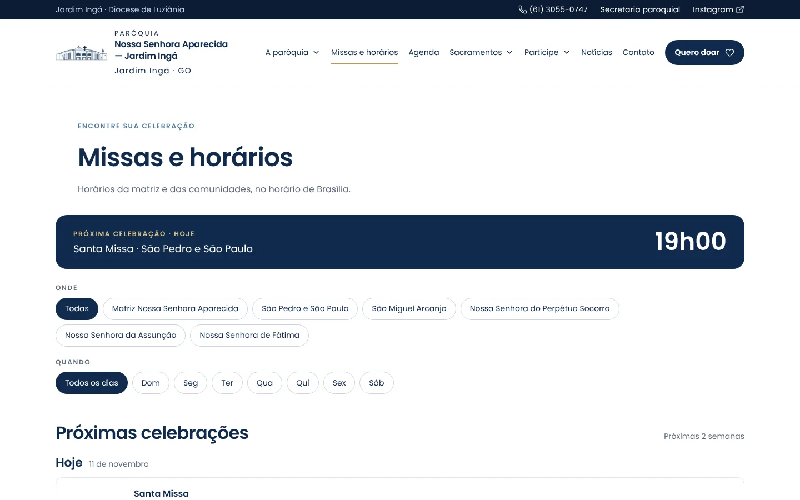<br><sub><b>Missas e horários</b> · próxima celebração e filtros em chips</sub></td>
    <td width="50%">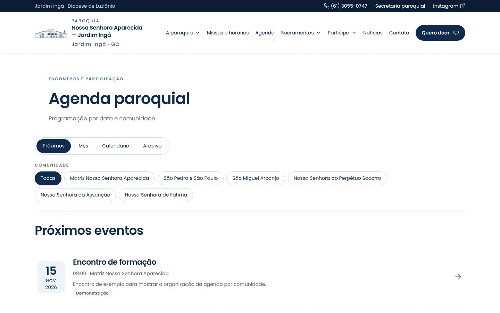<br><sub><b>Agenda</b> · próximos eventos, mês, calendário e arquivo</sub></td>
  </tr>
  <tr>
    <td>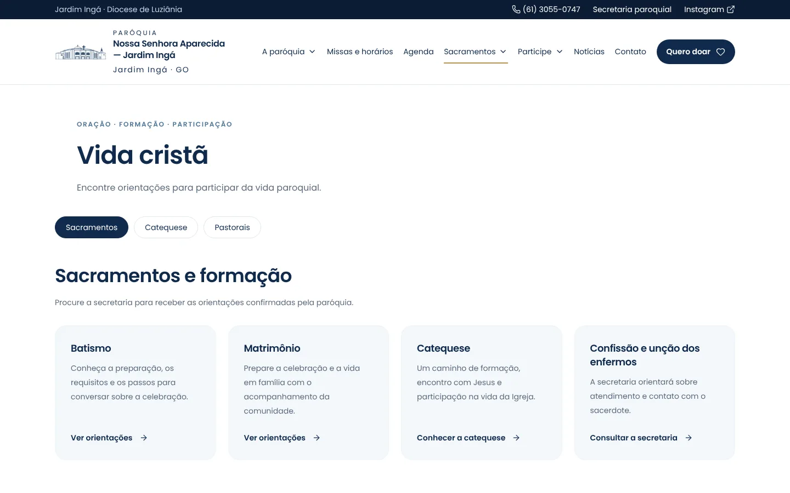<br><sub><b>Vida cristã</b> · sacramentos, catequese e pastorais</sub></td>
    <td>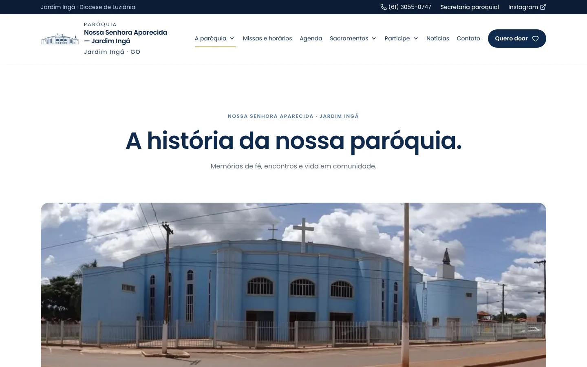<br><sub><b>A paróquia</b> · história e linha do tempo</sub></td>
  </tr>
  <tr>
    <td><br><sub><b>Comunicação</b> · destaques, notícias e reflexões</sub></td>
    <td>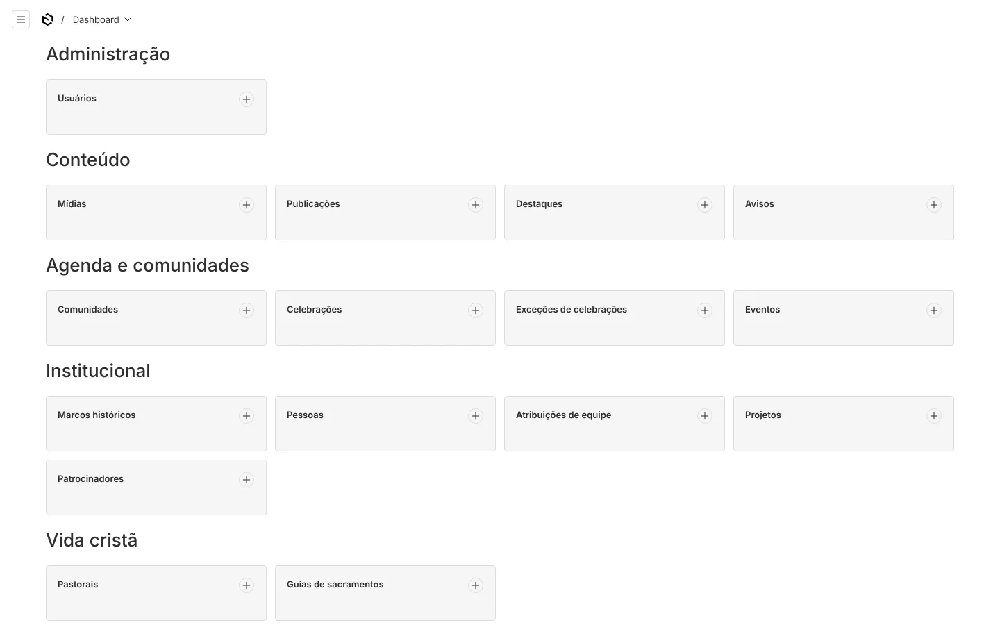<br><sub><b>Painel /admin</b> · coleções agrupadas por área</sub></td>
  </tr>
</table>

<table>
  <tr>
    <td align="center" width="33%"><br><sub><b>Celular</b> · página inicial</sub></td>
    <td align="center" width="33%">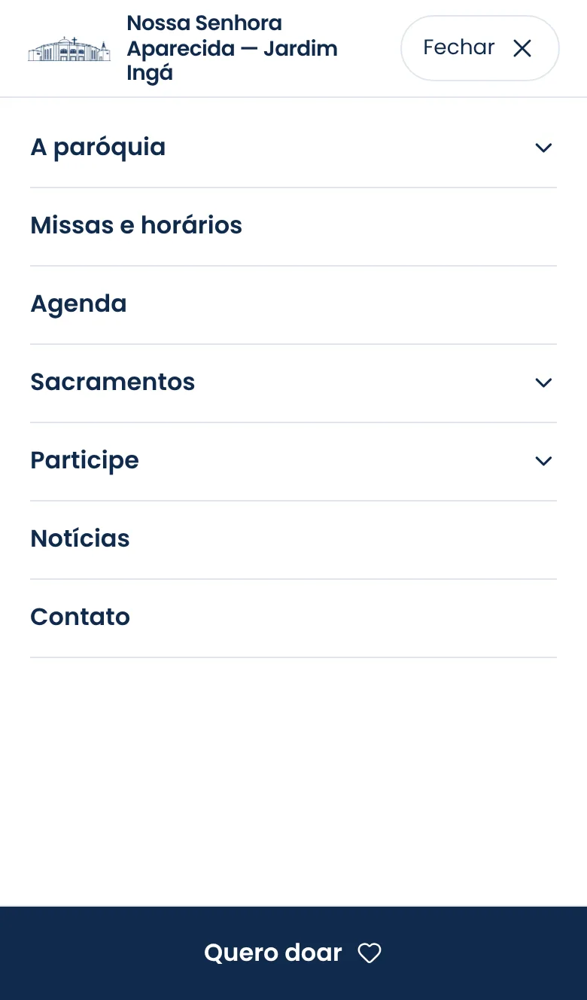<br><sub><b>Celular</b> · menu em tela cheia</sub></td>
    <td align="center" width="34%">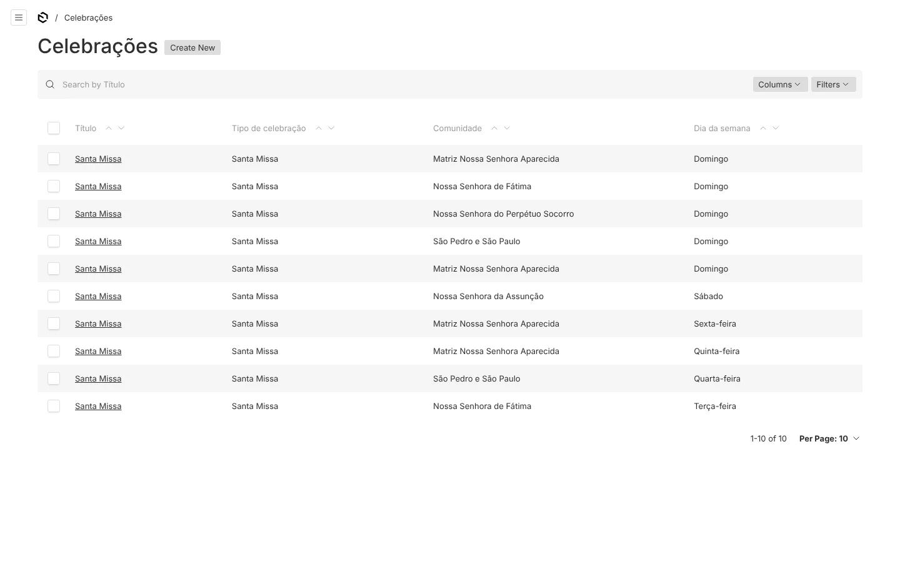<br><sub><b>Painel</b> · celebrações recorrentes</sub></td>
  </tr>
</table>

## Início rápido

Requisitos: Node.js 22.23.4 ou superior compatível, npm e Docker com Compose.

```bash
cp .env.example .env                           # defina um PAYLOAD_SECRET seguro
docker compose -f docker/postgres.yml up -d    # só o banco
npm install
npm run generate:types
npm run seed                                   # opcional: conteúdo de demonstração
npm run dev                                    # http://localhost:3000 e /admin
```

- **Primeiro usuário:** defina `PAYLOAD_ADMIN_EMAIL` e `PAYLOAD_ADMIN_PASSWORD` no `.env` antes do `npm run seed`. Sem elas, crie o usuário na tela `/admin`.
- **Seed idempotente:** pode ser executado de novo sem duplicar conteúdo.
- **Imagens antigas sem prévia:** se o banco já tinha imagens de antes do campo `blurData`, gere as prévias com `npm run media:blur`.
- **Conteúdo de demonstração:** em desenvolvimento ele aparece com o selo "Demonstração". Em produção, `SHOW_DEMO_CONTENT` deve ficar `false`.

> [!TIP]
> **Postgres fora do Docker:** deixe o servidor em UTC (`ALTER SYSTEM SET timezone = 'UTC'`). Com o fuso `America/Sao_Paulo`, o Postgres devolve datas históricas (como 1717, nos marcos da paróquia) com offset em segundos, `-03:06:28`, que o JavaScript não interpreta, e o seed falha com `RangeError: Invalid time value`. O container oficial do Postgres já roda em UTC.

## Arquitetura

O site público e o painel administrativo rodam no mesmo processo Next.js. O Payload CMS é uma biblioteca dentro da aplicação: as páginas consultam o conteúdo pela API local do Payload, direto no servidor, sem requisição HTTP entre "front" e "CMS".

<p align="center">
  
</p>

<details>
<summary>Fonte do diagrama (Mermaid)</summary>

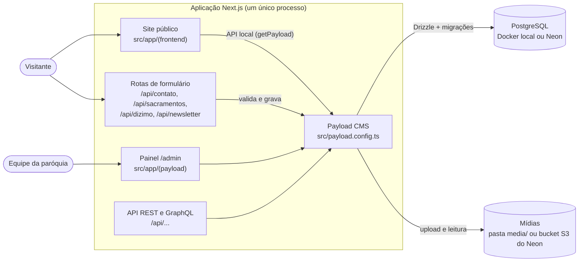

</details>

| Caminho | Conteúdo |
| --- | --- |
| `src/payload.config.ts` | Configuração central do Payload: coleções, globais, banco e storage |
| `src/collections/` | Coleções, uma por arquivo |
| `src/globals/` | Globais: configuração do site e conteúdo de páginas únicas |
| `src/access/` | Regras de acesso por função |
| `src/fields/` | Campos reutilizados (origem e verificação editorial) |
| `src/app/(frontend)/` | Páginas públicas, rotas de formulário, `tokens.css` e `styles.css` |
| `src/app/(payload)/` | Painel `/admin` e API do Payload |
| `src/components/` | Componentes React do site, com CSS Modules |
| `src/lib/` | Datas, calendário, horários, próxima celebração, formulários, prévia de imagens |
| `src/migrations/` | Migrações de schema |
| `scripts/` | Seed, mídias, backup, restauração e geração das imagens do README |
| `tests/` | Integração (Vitest) e ponta a ponta (Playwright + axe) |
| `docs/` | Dossiê do projeto, protótipo de referência e imagens do README |

### Do pedido ao banco

O Payload é configurado por código. A partir das coleções e globais ele gera as tabelas no PostgreSQL (via Drizzle), os formulários do painel, a API REST e GraphQL e os tipos TypeScript em `src/payload-types.ts` (`npm run generate:types`). Em desenvolvimento, o schema é sincronizado direto no banco (push). Em produção, o push fica desligado e as mudanças entram por migrações em `src/migrations`.

<p align="center">
  
</p>

<details>
<summary>Fonte do diagrama (Mermaid)</summary>

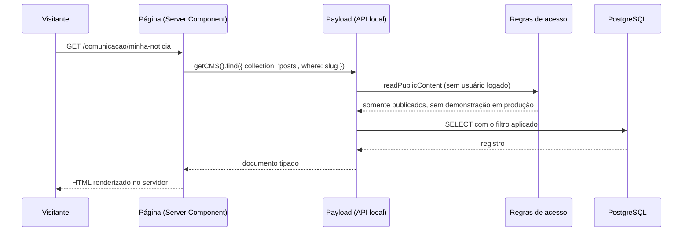

</details>

## Conteúdo no Payload

O painel foi organizado para quem não é da área técnica: está em português, os menus e campos usam os mesmos nomes que aparecem no site, e a tela inicial tem atalhos para as tarefas do dia a dia ("Publicar uma notícia", "Avisar mudança de missa").

Cada **coleção** descreve um tipo de conteúdo com vários registros (notícias, eventos, pessoas). Cada **global** descreve um documento único (dados da paróquia, textos de uma página).

### Coleções

| Menu no painel | Nome no painel | Coleção (slug) | Para que serve |
| --- | --- | --- | --- |
| Notícias e avisos | Notícias | `posts` | Notícias, artigos, reflexões, álbuns de fotos e vídeos |
| Notícias e avisos | Banners do carrossel | `highlights` | Imagens grandes do topo da página inicial e de Notícias |
| Notícias e avisos | Avisos | `notices` | Faixas de recado com período de exibição |
| Missas e agenda | Missas e horários | `celebrations` | Horários fixos de missas, confissões e adoração |
| Missas e agenda | Mudanças e cancelamentos | `celebration-exceptions` | Cancelamento, troca de horário ou celebração extra em um dia |
| Missas e agenda | Eventos | `events` | Eventos com data, local e arquivo `.ics` |
| A paróquia | Comunidades | `communities` | Matriz e capelas |
| A paróquia | Clero e equipe | `people` | Padres, equipe e autores, com a função de cada um |
| A paróquia | Pastorais e movimentos | `pastorals` | Pastorais, movimentos e grupos |
| A paróquia | Sacramentos | `sacrament-guides` | Orientações de batismo, catequese e matrimônio |
| A paróquia | Projetos | `projects` | Projetos e parcerias |
| A paróquia | Patrocinadores | `sponsors` | Patrocinadores (só aparecem depois de aprovados) |
| Mensagens recebidas | Fale conosco | `contact-messages` | Mensagens do formulário de contato |
| Mensagens recebidas | Pedidos de sacramentos | `sacrament-requests` | Pedidos de batismo e casamento |
| Mensagens recebidas | Interessados no dízimo | `tithe-interests` | Pedidos de contato sobre o dízimo |
| Mensagens recebidas | Inscritos nas novidades | `newsletter-subscribers` | E-mails inscritos na newsletter |
| Imagens | Imagens | `media` | Fotos e artes; para enviar, só a descrição é obrigatória |
| Configurações | Usuários | `users` | Quem entra no painel e o que pode fazer |

Cada função vê só os menus que usa: a secretaria vê as mensagens recebidas, colaboradores e editores veem o conteúdo, e só o administrador vê usuários.

Relações entre as coleções (a seta aponta para a coleção referenciada):

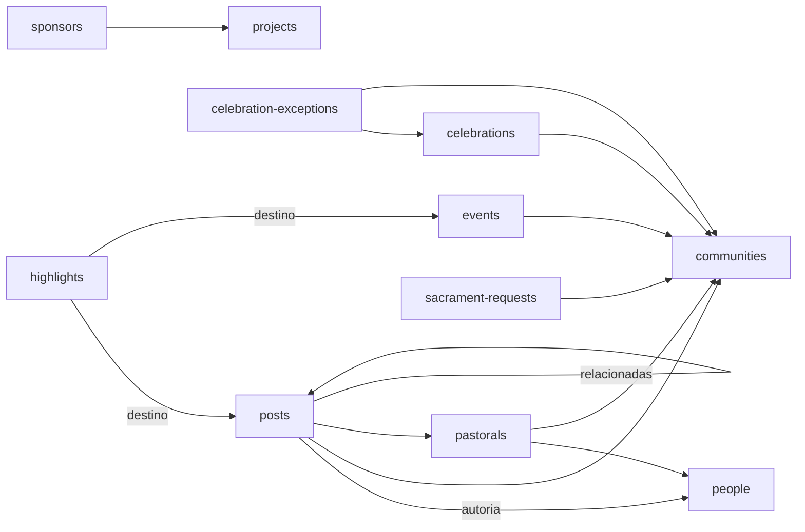

A coleção `media` ficou fora do diagrama para não poluí-lo: ela é referenciada por `posts`, `highlights`, `events`, `communities`, `people`, `pastorals`, `projects` e `sponsors`.

### Globais

| Menu no painel | Nome no painel | Global (slug) | Para que serve |
| --- | --- | --- | --- |
| Páginas do site | Página inicial | `home-page` | Títulos e textos de cada seção da página inicial, em abas |
| Páginas do site | Página Secretaria | `secretariat-page` | Textos de `/secretaria` |
| Páginas do site | Página Contato | `contact-page` | Textos de `/contato` |
| Configurações | Dados da paróquia | `site-settings` | Nome, endereço, telefones, redes sociais, horário da secretaria |

### Prévia ao vivo

Notícias, eventos, comunidades, pastorais e as três páginas acima têm um botão de prévia (ícone de olho) na tela de edição. Ele abre a página real ao lado do formulário e atualiza enquanto a pessoa digita; o que está publicado só muda ao clicar em "Publicar alterações".

Como funciona: o painel abre `/preview?path=...`, que confere o login e liga o modo de rascunho do Next.js. Nesse modo, `getCMS()` (`src/lib/payload.ts`) devolve o último rascunho no lugar do conteúdo publicado, em qualquer página. Fora do painel, uma barra avisa que a prévia está ativa e oferece o link para sair.

### O que fica no código, não no CMS

Conteúdo que se escreve uma vez e quase nunca muda fica em arquivos, para o painel ter só o que a equipe edita de fato. Para alterar, edite o arquivo e faça o deploy.

| Conteúdo | Arquivo |
| --- | --- |
| História da paróquia e sua linha do tempo (`/paroquia`) | `src/content/history.ts` |
| Padroeira, linha do tempo, curiosidades e fontes (`/padroeira`) | `src/content/patron.ts` |
| Dízimo e doações, Espiritualidade, In Cordibus Pastorum, Mural do dízimo | `src/content/life.ts` |
| Menus do cabeçalho e do rodapé | `src/components/site/navigation.ts` |
| Imagens dessas páginas | `public/images/` |

## Fluxo editorial e permissões

As coleções de conteúdo têm rascunhos (`versions.drafts`) e os campos editoriais de `src/fields/editorial.ts`: **origem** (oficial, pesquisa externa, acervo histórico, demonstração) e **verificação** (pendente, revisado, aprovado pela paróquia). No site, a origem aparece como um selo discreto ("Demonstração", "Em confirmação"), nunca como texto no título.

<p align="center">
  
</p>

<details>
<summary>Fonte do diagrama (Mermaid)</summary>

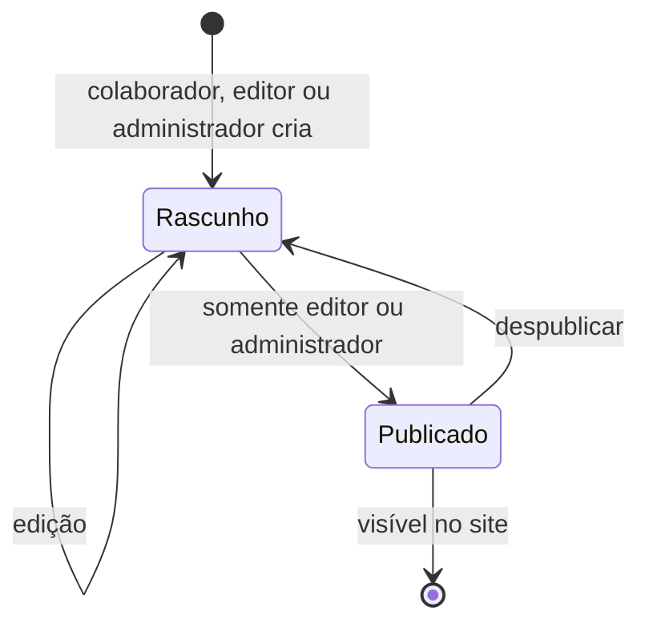

</details>

O que cada função pode fazer (regras em `src/access/index.ts`):

| Ação | Administrador | Editor | Colaborador | Secretaria |
| --- | :-: | :-: | :-: | :-: |
| Criar e editar rascunhos de conteúdo | ✅ | ✅ | ✅ | — |
| Publicar e excluir conteúdo | ✅ | ✅ | — | — |
| Enviar mídias e editar globais | ✅ | ✅ | — | — |
| Ler e tratar atendimentos privados | ✅ | — | — | ✅ |
| Gerenciar usuários | ✅ | — | — | — |

Visitantes sem login só enxergam conteúdo publicado. Conteúdo com origem "demonstração" aparece enquanto o site é protótipo; defina `SHOW_DEMO_CONTENT=false` para escondê-lo em produção. Os campos de origem e verificação só aparecem para administradores.

## Formulários públicos

Os registros de atendimento não podem ser criados pela API pública do Payload. Eles entram apenas pelas rotas de formulário, que validam os dados no servidor (`src/lib/form-server.ts`) antes de gravar.

<p align="center">
  
</p>

<details>
<summary>Fonte do diagrama (Mermaid)</summary>

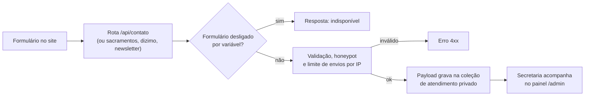

</details>

Enquanto o site é um protótipo em validação, todos os recursos ficam **ligados por padrão** (`src/lib/features.ts`). Para desligar um deles, defina a variável como `false`:

```env
CONTACT_FORM_ENABLED=false
SACRAMENT_FORM_ENABLED=false
TITHE_FORM_ENABLED=false
NEWSLETTER_ENABLED=false
SHOW_DEMO_CONTENT=false
```

Antes do lançamento oficial, desligue o que a paróquia ainda não aprovou (responsáveis, atendimento e retenção de dados).

Onde cada formulário aparece (componentes em `src/components/forms/`):

| Formulário | Página | Rota |
| --- | --- | --- |
| Fale conosco | `/contato` | `/api/contato` |
| Pedido de batismo ou casamento | `/vida/batismo` e `/vida/matrimonio`, quando o campo "Formulário de pedido na página" do sacramento está preenchido | `/api/sacramentos` |
| Interesse no dízimo | `/vida/mural-do-dizimo` | `/api/dizimo` |
| Novidades por e-mail | faixa acima do rodapé, em todas as páginas | `/api/newsletter` |

Com a variável de um formulário em `false`, a página volta a mostrar só os canais da secretaria.

Solicitações de sacramento não reservam datas. A newsletter começa como pendente e tem confirmação e descadastro por token; o envio de e-mails exige configurar um provedor real.

## Sistema visual

A identidade é azul-marinho, dourado e Poppins. Os valores ficam em `src/app/(frontend)/tokens.css` e todos os módulos usam as variáveis:

| Tokens | Regra |
| --- | --- |
| **Cores** | `--navy-*`, `--blue-*`, `--gold-*`, `--ink`, `--muted`, `--line`. Nenhum hex fora do `tokens.css`. Dourado 500 é só decoração; para texto, `--gold-700`. |
| **Tipografia** | Só Poppins (400, 500 e 600, woff2 via `next/font/local`). Base 16px, mínimo 14px; 12px apenas no eyebrow em caixa alta. Horários com `tabular-nums`. |
| **Breakpoints** | Quatro, sempre `max-width`: `480px` · `768px` · `1024px` · `1280px`. |
| **Raios e sombras** | 8, 12, 20 e pill; sombras `--shadow-sm` (cards) e `--shadow` (dropdown, drawer). |
| **Movimento** | `--dur-fast` 120ms, `--dur-base` 200ms, `--dur-slow` 320ms, `--ease-out`. Tudo desligado com `prefers-reduced-motion`. |
| **Ícones** | [Lucide](https://lucide.dev) via `lucide-react`, pela mesma API `<Icon name="…" />`. O `SmartLink` adiciona o ícone de link externo sozinho. |

Testes de integração barram desvios: `tests/int/design-tokens.int.spec.ts` falha com cor fora dos tokens, e `tests/int/breakpoints.int.spec.ts` falha com breakpoint fora dos quatro.

## Scripts

| Comando | O que faz |
| --- | --- |
| `npm run dev` | Desenvolvimento com push automático do schema |
| `npm run build` / `npm start` | Build e servidor de produção |
| `npm run seed` | Conteúdo de demonstração e admin inicial (idempotente) |
| `npm run generate:types` | Regenera `src/payload-types.ts` |
| `npm run payload -- migrate` | Aplica migrações (`migrate:create` para gerar uma nova) |
| `npm run media:blur` | Gera a prévia desfocada das imagens enviadas antes do campo existir |
| `npm run media:upload` | Envia ao bucket do Neon as mídias que estão em `media/` |
| `npm run lint` | ESLint |
| `npm run test:int` / `npm run test:e2e` | Testes de integração e ponta a ponta |
| `npm run docs:telas` | Regenera os prints do README (servidor rodando) |
| `npm run docs:diagramas` | Regenera os diagramas animados do README (requer `ffmpeg`) |

## Testes e verificação

```bash
npm run generate:types
npx tsc --noEmit
npm run lint
npm run test:int
npm run test:e2e
npm run build
```

| Suíte | Cobre |
| --- | --- |
| `tests/int` (Vitest) | Regras de acesso, fuso `America/Sao_Paulo`, exceções de celebrações, calendário, formulários, tokens de cor e breakpoints |
| `tests/e2e/navigation` | Dropdown que fecha com clique fora, Esc e troca de rota; um aberto por vez; seção atual marcada; menu mobile; 404 |
| `tests/e2e/flows` | Próxima celebração, filtros sem botão, agenda com seletor único, nenhum texto de bastidor nas páginas públicas |
| `tests/e2e/a11y` | axe (WCAG 2.1 AA) nas rotas principais e screenshots em 375, 768 e 1366px sem rolagem horizontal |
| `tests/e2e/frontend` e `admin` | Todas as rotas públicas, arquivo `.ics` e cadastros do painel |

> [!WARNING]
> `npm run test:int` e `npm run test:e2e` usam o `.env` e criam e apagam registros. Não rode os testes com o `.env` apontando para um banco com dados reais.

## Banco e mídias no Neon (opcional)

Em vez do Postgres local, o projeto pode usar um banco Neon e guardar as mídias no Neon Object Storage (compatível com S3). O arquivo `neon.ts` declara o bucket `uploads`.

1. Instale a CLI e vincule o projeto (o vínculo fica em `.neon`, fora do Git):

   ```bash
   npm install -g neon@latest
   neon login
   neon link --project-id <id-do-projeto> --branch production
   ```

2. Crie o bucket e grave as variáveis no `.env`:

   ```bash
   neon deploy
   ```

   O comando preenche `DATABASE_URL`, `DATABASE_URL_UNPOOLED`, `AWS_ACCESS_KEY_ID`, `AWS_SECRET_ACCESS_KEY`, `AWS_ENDPOINT_URL_S3` e `AWS_REGION`. Ele reescreve `DATABASE_URL` a cada execução, assim como `neon env pull`.

3. Defina `MEDIA_BUCKET=uploads` no `.env`. Com essa variável, os uploads do Payload vão para o bucket; sem ela, ficam na pasta local `media/`.
4. Aplique as migrações e, se quiser, o conteúdo de demonstração:

   ```bash
   npm run payload -- migrate
   npm run seed
   ```

5. Envie ao bucket os arquivos que já estão em `media/` e são referenciados pelo banco (idempotente: arquivos já presentes com o mesmo tamanho são ignorados):

   ```bash
   npm run media:upload
   ```

Observações:

- O bucket é privado. As imagens continuam em `/api/media/file/...`, com o Payload lendo do bucket a cada requisição; em produção, use cache ou CDN na frente.
- `npm run dev` sincroniza o schema direto no banco (push). Depois disso, `payload migrate` pede uma confirmação interativa antes de aplicar novas migrações.
- `scripts/backup.sh` e `scripts/restore.sh` cobrem apenas o Postgres e a pasta `media` do Docker, não o Neon.

## Deploy na Vercel

O arquivo `vercel.json` define o build (`npm run ci`, que roda `scripts/ci.mjs`: aplica as migrações e depois o `next build`) e a região `cle1`, a mais próxima do banco Neon em `us-east-2`.

1. Importe o repositório na Vercel.
2. Em Settings → Environment Variables, cadastre:

   | Variável | Valor |
   | --- | --- |
   | `DATABASE_URL` | URL do banco Neon (pooler) |
   | `PAYLOAD_SECRET` | Segredo longo e aleatório, diferente do usado em desenvolvimento |
   | `NEXT_PUBLIC_SITE_URL` | Opcional. URL pública do site, com `https://`. Sem ela (ou com `localhost`), o site usa o endereço que a própria Vercel informa |
   | `MEDIA_BUCKET` | `uploads` |
   | `AWS_ACCESS_KEY_ID`, `AWS_SECRET_ACCESS_KEY`, `AWS_ENDPOINT_URL_S3`, `AWS_REGION` | Credenciais do Neon Object Storage (as mesmas que `neon deploy` grava no `.env`) |
   | `SHOW_DEMO_CONTENT`, `CONTACT_FORM_ENABLED` e demais recursos | Opcionais. Ligados por padrão; use `false` para desligar |

3. Faça o deploy.

Observações:

- `MEDIA_BUCKET` é obrigatório na Vercel: o disco das funções é somente leitura, então uploads na pasta `media/` não funcionam.
- Não rode `npm run dev` com push contra o banco de produção: o push grava um registro `dev` em `payload_migrations`, e com ele o `payload migrate` do build para numa pergunta interativa e o deploy trava. Se o `.env` local apontar para o banco de produção, defina `PAYLOAD_DB_PUSH=false` e altere o schema só por migrações (`npm run payload -- migrate:create` e `migrate`).
- O limite de envios dos formulários fica na memória de cada instância; em ambiente serverless ele não é compartilhado entre instâncias.

### Homologação (branch `homolog`)

A branch `homolog` do Git é o ambiente de validação. Cada push nela gera um deploy de preview na Vercel com banco e arquivos próprios, separados da produção:

- No Neon existe uma branch `homolog`, criada a partir de `production`. Ela herda a senha do banco e as credenciais do bucket; só os endereços mudam.
- `src/lib/deploy-env.ts` troca esses endereços quando o deploy é da branch `homolog`, usando as mesmas variáveis de ambiente da produção. Nada precisa ser cadastrado na Vercel. Se o deploy não conseguir apontar para o banco de homologação, ele falha em vez de tocar na produção.
- Previews de qualquer outra branch usam o banco de produção e por isso **não** aplicam migrações (`scripts/ci.mjs`).

Para trabalhar localmente na homologação:

```bash
git checkout homolog
neon checkout homolog      # aponta o .env para a branch homolog do Neon
npm run payload -- migrate
npm run dev
```

Para voltar o `.env` à produção: `neon checkout production`. Se a branch do Neon for recriada, atualize os identificadores no topo de `src/lib/deploy-env.ts`.

Para promover a homologação: faça o merge de `homolog` em `main`. O deploy de produção aplica as migrações pendentes, incluindo a que remove do banco as coleções e páginas que passaram para o código.

## Produção com Docker

1. Configure `.env` com URL pública HTTPS, segredo e credenciais fortes de banco.
2. Construa a imagem e execute as migrações:

   ```bash
   docker compose build
   docker compose run --rm app npm run payload -- migrate
   ```

3. Suba os serviços:

   ```bash
   docker compose up -d
   ```

`pgdata` e `media` são volumes persistentes. Em produção, alterações de schema usam `src/migrations`; o push automático fica desabilitado. Configure HTTPS por proxy reverso e mantenha a porta do PostgreSQL inacessível publicamente.

## Backup e restauração

Com os serviços de produção ativos:

```bash
scripts/backup.sh
```

O backup contém dump do PostgreSQL, mídia e checksums em `backups/<data UTC>`. Copie esse diretório para um destino separado. Para o banco local do arquivo `docker/postgres.yml`:

```bash
COMPOSE_FILE="$PWD/docker/postgres.yml" scripts/backup.sh
```

A restauração substitui dados e exige confirmação explícita:

```bash
CONFIRM_RESTORE=yes scripts/restore.sh backups/AAAAMMDDTHHMMSSZ
```

Teste a restauração periodicamente em ambiente separado antes de depender do backup.

## Documentação visual do README

As imagens deste README são geradas a partir do próprio projeto, então dá para atualizá-las sempre que o site mudar:

- **Prints** (`docs/readme/telas/*.webp`): `scripts/readme-telas.mjs` abre o site com Playwright em 1440px e no iPhone 13. Rode com o seed aplicado e o servidor de pé (`npm run build && npm start`), depois `npm run docs:telas`. Com `PAYLOAD_ADMIN_EMAIL` e `PAYLOAD_ADMIN_PASSWORD` no `.env`, ele também fotografa o painel.
- **Diagramas animados** (`docs/readme/diagramas/*.gif`): cada diagrama é um SVG descrito em `docs/readme/diagramas/fonte/specs.js` e animado com [Motion](https://motion.dev) (`fonte/vendor/motion.js`, licença MIT). `npm run docs:diagramas` avança a timeline quadro a quadro com Playwright e monta o GIF com `ffmpeg`. Para ver a animação ao vivo, sirva a raiz do repositório (`npx serve .`) e abra `docs/readme/diagramas/fonte/index.html?d=arquitetura`.

Ao mudar uma relação ou um fluxo, atualize o bloco Mermaid correspondente e o `specs.js`: o Mermaid continua sendo a fonte textual, e o GIF é a versão ilustrada.

## Pendências institucionais

Antes da publicação oficial, confirme contatos, horários divergentes, equipe, pastorais, história, requisitos de sacramentos, projetos, patrocinadores e canais de doação. Não publique placeholders, exemplos ou dados financeiros sem aprovação. O dossiê completo está em `docs/DOSSIE-DESENVOLVIMENTO-PAROQUIA.md`.
