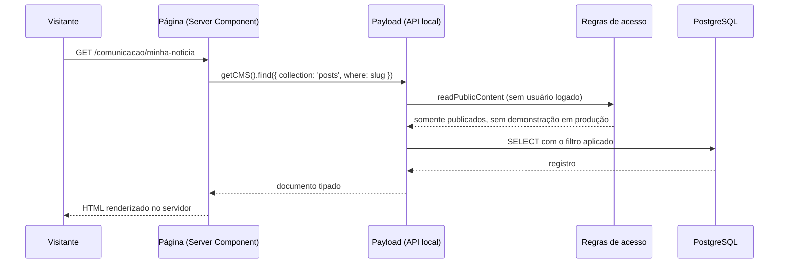
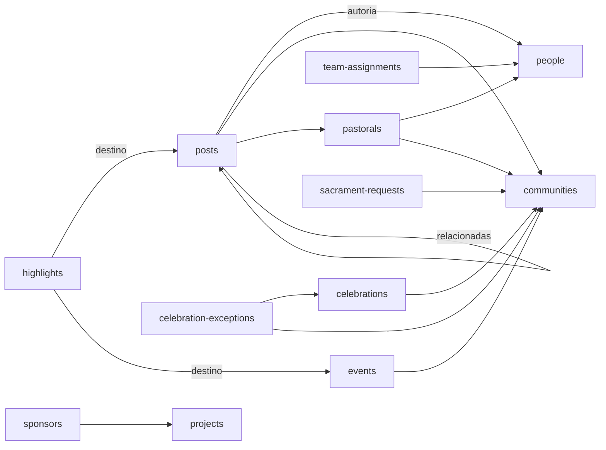
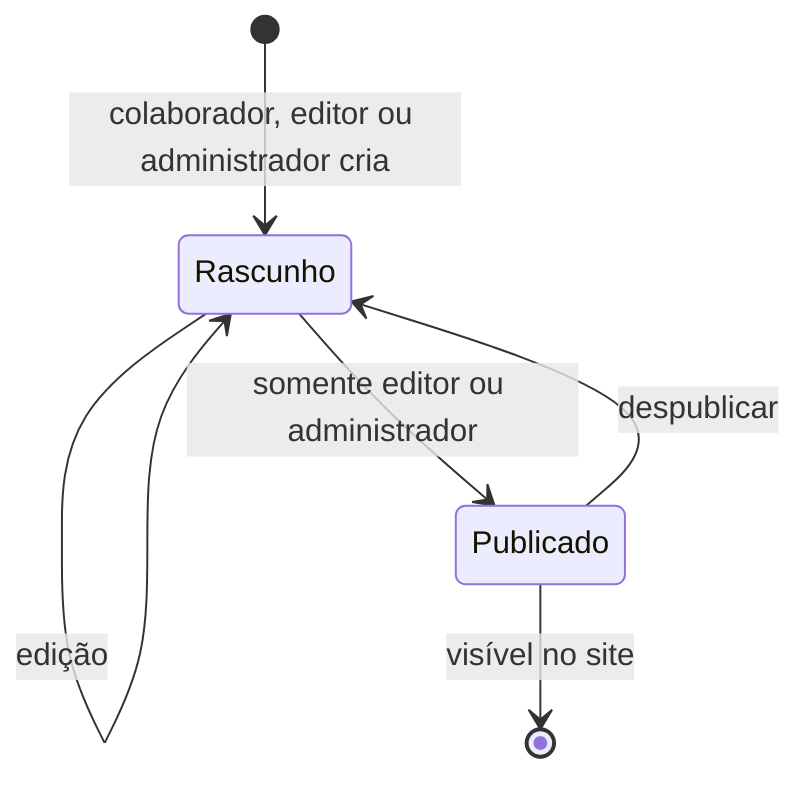
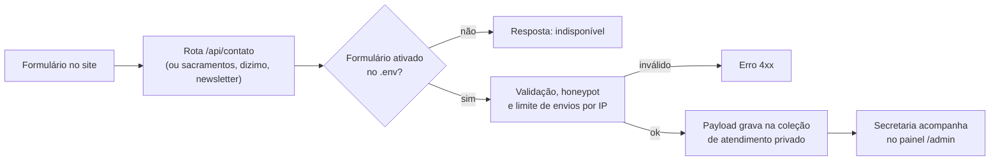

# Paróquia Nossa Senhora Aparecida — Jardim Ingá


Portal institucional com Next.js, Payload CMS e PostgreSQL. O conteúdo do protótipo em `docs/prototipo` é referência de desenvolvimento: exemplos, pesquisa e acervo permanecem identificados no CMS e não devem ser tratados como informação oficial sem revisão.

## Arquitetura

O site público e o painel administrativo rodam no mesmo processo Next.js. O Payload CMS é uma biblioteca dentro da aplicação: as páginas consultam o conteúdo chamando a API local do Payload direto no servidor, sem requisição HTTP entre "front" e "CMS".


Organização do código:

| Caminho | Conteúdo |
| --- | --- |
| `src/payload.config.ts` | Configuração central do Payload: coleções, globais, banco, storage |
| `src/collections/` | Coleções (uma por arquivo) |
| `src/globals/` | Globais: configuração do site e conteúdo de páginas únicas |
| `src/access/` | Regras de acesso por função |
| `src/fields/` | Campos reutilizados (origem e verificação editorial) |
| `src/app/(frontend)/` | Páginas públicas e rotas de formulário |
| `src/app/(payload)/` | Painel `/admin` e API do Payload |
| `src/components/` | Componentes React do site |
| `src/lib/` | Datas, calendário, horários, formulários, acesso ao CMS |
| `src/migrations/` | Migrações de schema |
| `scripts/` | Seed, envio de mídias, backup e restauração |
| `tests/` | Testes de integração (Vitest) e ponta a ponta (Playwright) |

### Como o Payload funciona neste projeto

O Payload é configurado por código. Cada **coleção** descreve um tipo de conteúdo com vários registros (publicações, eventos, pessoas); cada **global** descreve um documento único (configurações do site, texto de uma página). A partir dessas definições o Payload gera:

- as tabelas no PostgreSQL (via Drizzle);
- os formulários do painel `/admin`;
- a API REST e GraphQL em `/api`;
- os tipos TypeScript em `src/payload-types.ts` (`npm run generate:types`).

Em desenvolvimento, o schema é sincronizado direto no banco a cada alteração (push). Em produção, o push fica desligado e as mudanças entram por migrações em `src/migrations`.

Caminho de uma página pública até o banco:



### Coleções

As coleções aparecem no painel agrupadas assim:

| Grupo no painel | Coleção (slug) | Para que serve |
| --- | --- | --- |
| Conteúdo | `posts` | Publicações: notícias e reflexões |
| Conteúdo | `highlights` | Destaques do carrossel da página inicial |
| Conteúdo | `notices` | Avisos com período de exibição |
| Conteúdo | `media` | Imagens, com descrição, crédito e autorização de uso |
| Agenda e comunidades | `communities` | Comunidades da paróquia |
| Agenda e comunidades | `celebrations` | Celebrações recorrentes (horários de missa) |
| Agenda e comunidades | `celebration-exceptions` | Cancelamentos e mudanças pontuais de celebrações |
| Agenda e comunidades | `events` | Eventos com data, local e arquivo `.ics` |
| Institucional | `people` | Pessoas (clero, equipe, autores) |
| Institucional | `team-assignments` | Funções que cada pessoa exerce |
| Institucional | `milestones` | Marcos da história da paróquia |
| Institucional | `projects` | Projetos |
| Institucional | `sponsors` | Patrocinadores |
| Vida cristã | `pastorals` | Pastorais e movimentos |
| Vida cristã | `sacrament-guides` | Guias de sacramentos (batismo, matrimônio, catequese) |
| Atendimento privado | `contact-messages` | Mensagens do formulário de contato |
| Atendimento privado | `sacrament-requests` | Solicitações de sacramentos |
| Atendimento privado | `tithe-interests` | Interesses no dízimo |
| Atendimento privado | `newsletter-subscribers` | Assinantes da newsletter |
| Administração | `users` | Usuários do painel e suas funções |

Relações entre as coleções (a seta aponta para a coleção referenciada):



A coleção `media` ficou fora do diagrama para não poluí-lo: ela é referenciada por `posts`, `highlights`, `events`, `communities`, `people`, `pastorals`, `projects`, `sponsors` e `milestones`.

### Globais

| Grupo no painel | Global (slug) | Para que serve |
| --- | --- | --- |
| Configuração | `site-settings` | Nome, contatos e dados gerais do site |
| Configuração | `navigation` | Menus do cabeçalho e do rodapé |
| Páginas | `home-page` | Página inicial |
| Páginas | `history-page` | História da paróquia (`/paroquia`) |
| Páginas | `patron-page` | Padroeira (`/padroeira`) |
| Páginas | `secretariat-page` | Secretaria (`/secretaria`) |
| Páginas | `contact-page` | Contato (`/contato`) |
| Páginas | `contribution-page` | Contribuição (`/contribuir`) |
| Páginas | `spirituality-page` | Espiritualidade (`/vida/espiritualidade`) |
| Páginas | `pastorum-page` | In Cordibus Pastorum (`/vida/in-cordibus-pastorum`) |
| Páginas | `tithe-wall-page` | Mural do dízimo (`/vida/mural-do-dizimo`) |

### Fluxo editorial e permissões

As coleções de conteúdo têm rascunhos (`versions.drafts`) e os campos editoriais de `src/fields/editorial.ts`: **origem** (oficial, pesquisa externa, acervo histórico, demonstração) e **verificação** (pendente, revisado, aprovado pela paróquia).



O que cada função pode fazer (regras em `src/access/index.ts`):

| Ação | Administrador | Editor | Colaborador | Secretaria |
| --- | :-: | :-: | :-: | :-: |
| Criar e editar rascunhos de conteúdo | ✅ | ✅ | ✅ | — |
| Publicar e excluir conteúdo | ✅ | ✅ | — | — |
| Enviar mídias e editar globais | ✅ | ✅ | — | — |
| Ler e tratar atendimentos privados | ✅ | — | — | ✅ |
| Gerenciar usuários | ✅ | — | — | — |

Visitantes sem login só enxergam conteúdo publicado. Conteúdo com origem "demonstração" some do site em produção, a menos que `SHOW_DEMO_CONTENT=true`.

### Formulários públicos

Os registros de atendimento não podem ser criados pela API pública do Payload. Eles entram apenas pelas rotas de formulário, que validam os dados no servidor (`src/lib/form-server.ts`) antes de gravar:



## Desenvolvimento local

Requisitos: Node.js 22.23.4 ou superior compatível, npm e Docker com Compose.

1. Copie `.env.example` para `.env` e defina um `PAYLOAD_SECRET` seguro.
2. Suba apenas o banco local:

   ```bash
   docker compose -f docker/postgres.yml up -d
   ```

3. Instale e prepare o projeto:

   ```bash
   npm install
   npm run generate:types
   ```

4. Opcionalmente, defina `PAYLOAD_ADMIN_EMAIL` e `PAYLOAD_ADMIN_PASSWORD` no `.env` e execute `npm run seed`. O seed é idempotente e importa conteúdo de demonstração. Sem essas variáveis, crie o primeiro usuário pela tela `/admin`.
5. Inicie a aplicação com `npm run dev` e abra `http://localhost:3000`.

Em desenvolvimento, demonstrações publicadas são visíveis. Em produção, `SHOW_DEMO_CONTENT` deve permanecer `false`.

## Banco e mídias no Neon (opcional)

Em vez do Postgres local, o projeto pode usar um banco Neon e guardar as mídias no Neon Object Storage (compatível com S3). O arquivo `neon.ts` declara o bucket `uploads`.

1. Instale a CLI e vincule o projeto (o vínculo fica em `.neon`, fora do Git):

   ```bash
   npm install -g neon@latest
   neon login
   neon link --project-id <id-do-projeto> --branch production
   ```

2. Crie o bucket e grave as variáveis no `.env`:

   ```bash
   neon deploy
   ```

   O comando preenche `DATABASE_URL`, `DATABASE_URL_UNPOOLED`, `AWS_ACCESS_KEY_ID`, `AWS_SECRET_ACCESS_KEY`, `AWS_ENDPOINT_URL_S3` e `AWS_REGION`. Ele reescreve `DATABASE_URL` a cada execução, assim como `neon env pull`.

3. Defina `MEDIA_BUCKET=uploads` no `.env`. Com essa variável, os uploads do Payload vão para o bucket; sem ela, ficam na pasta local `media/`.
4. Aplique as migrações e, se quiser, o conteúdo de demonstração:

   ```bash
   npm run payload -- migrate
   npm run seed
   ```

5. Para enviar ao bucket os arquivos que já estão em `media/` e são referenciados pelo banco:

   ```bash
   npm run media:upload
   ```

   O script é idempotente: arquivos já presentes com o mesmo tamanho são ignorados.

Observações:

- O bucket é privado. As imagens continuam em `/api/media/file/...`, com o Payload lendo do bucket a cada requisição; em produção, use cache ou CDN na frente.
- `npm run dev` sincroniza o schema direto no banco (push). Depois disso, `payload migrate` pede uma confirmação interativa antes de aplicar novas migrações.
- `npm run test:int` e `npm run test:e2e` usam o `.env` e criam e apagam registros. Não rode os testes com o `.env` apontando para um banco que guarde dados reais.
- `scripts/backup.sh` e `scripts/restore.sh` cobrem apenas o Postgres e a pasta `media` do Docker, não o Neon.

## Administração

O painel está em `/admin`. As funções são:

- **Administrador**: usuários, configuração, conteúdo e atendimento.
- **Editor**: cria, revisa e publica conteúdo.
- **Colaborador**: cria e edita rascunhos, sem publicar.
- **Secretaria**: acompanha contatos, solicitações e interesses privados.

Publicações, eventos, horários, comunidades, destaques e demais conteúdos possuem formulários estruturados em português. Rascunhos não são públicos. Observações internas e dados de atendimento têm acesso restrito.

## Formulários opcionais

Os fluxos ficam desativados até a paróquia definir responsáveis, atendimento e retenção. Para ativá-los após essa configuração:

```env
CONTACT_FORM_ENABLED=true
SACRAMENT_FORM_ENABLED=true
TITHE_FORM_ENABLED=true
NEWSLETTER_ENABLED=true
```

Os endpoints validam e persistem os dados antes de responder sucesso. Solicitações de sacramento não reservam datas. Newsletter começa como pendente e possui confirmação/descadastro por token; o envio de e-mails exige configurar um provedor real.

## Verificação

```bash
npm run generate:types
npx tsc --noEmit
npm run lint
npm run test:int
npm run test:e2e
npm run build
```

Os testes cobrem regras de acesso, fuso `America/Sao_Paulo`, exceções de celebrações, calendário, navegação pública e administração.

## Deploy na Vercel

O arquivo `vercel.json` define o build (`npm run ci`, que aplica as migrações e depois roda `next build`) e a região `cle1`, a mais próxima do banco Neon em `us-east-2`.

1. Importe o repositório na Vercel.
2. Em Settings → Environment Variables, cadastre:

   | Variável | Valor |
   | --- | --- |
   | `DATABASE_URL` | URL do banco Neon (pooler) |
   | `PAYLOAD_SECRET` | Segredo longo e aleatório, diferente do usado em desenvolvimento |
   | `NEXT_PUBLIC_SITE_URL` | URL pública do site, com `https://` |
   | `MEDIA_BUCKET` | `uploads` |
   | `AWS_ACCESS_KEY_ID`, `AWS_SECRET_ACCESS_KEY`, `AWS_ENDPOINT_URL_S3`, `AWS_REGION` | Credenciais do Neon Object Storage (as mesmas que `neon deploy` grava no `.env`) |
   | `SHOW_DEMO_CONTENT` | `false` |
   | `CONTACT_FORM_ENABLED` e demais formulários | `true` apenas quando a paróquia definir o atendimento |

3. Faça o deploy.

Observações:

- `MEDIA_BUCKET` é obrigatório na Vercel: o disco das funções é somente leitura, então uploads na pasta `media/` não funcionam.
- Se o banco de produção já foi usado com `npm run dev`, a tabela `payload_migrations` guarda um registro `dev`. Nesse caso `payload migrate` pede confirmação e, sem terminal, encerra sem aplicar nada: o build segue com o schema antigo. Use uma branch separada do Neon para desenvolvimento, ou remova esse registro antes de depender de novas migrações.
- O limite de envios dos formulários fica na memória de cada instância; em ambiente serverless ele não é compartilhado entre instâncias.

## Produção com Docker

1. Configure `.env` com URL pública HTTPS, segredo e credenciais fortes de banco.
2. Construa a imagem e execute as migrações:

   ```bash
   docker compose build
   docker compose run --rm app npm run payload -- migrate
   ```

3. Suba os serviços:

   ```bash
   docker compose up -d
   ```

`pgdata` e `media` são volumes persistentes. Em produção, alterações de schema usam `src/migrations`; o push automático fica desabilitado. Configure HTTPS por proxy reverso e mantenha a porta do PostgreSQL inacessível publicamente.

## Backup e restauração

Com os serviços de produção ativos:

```bash
scripts/backup.sh
```

O backup contém dump do PostgreSQL, mídia e checksums em `backups/<data UTC>`. Copie esse diretório para um destino separado. Para o banco local do arquivo `docker/postgres.yml`:

```bash
COMPOSE_FILE="$PWD/docker/postgres.yml" scripts/backup.sh
```

A restauração substitui dados e exige confirmação explícita:

```bash
CONFIRM_RESTORE=yes scripts/restore.sh backups/AAAAMMDDTHHMMSSZ
```

Teste a restauração periodicamente em ambiente separado antes de depender do backup.

## Pendências institucionais

Antes da publicação oficial, confirme contatos, horários divergentes, equipe, pastorais, história, requisitos de sacramentos, projetos, patrocinadores e canais de doação. Não publique placeholders, exemplos ou dados financeiros sem aprovação. O dossiê completo está em `docs/DOSSIE-DESENVOLVIMENTO-PAROQUIA.md`.
